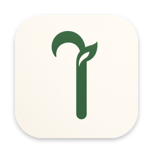
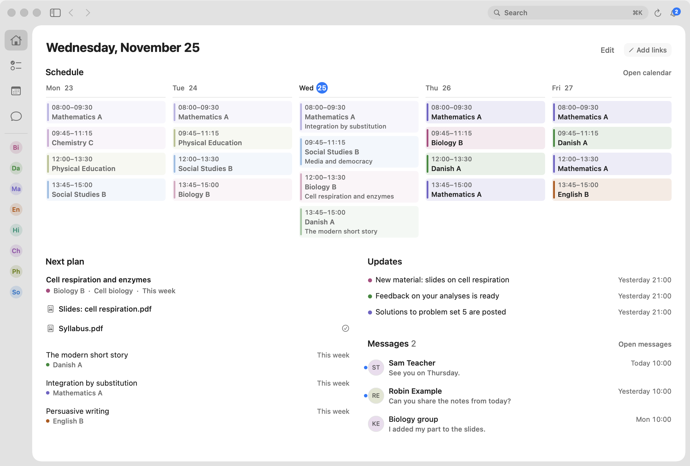

<p align="center">
  
</p>

<h1 align="center">Laer</h1>

<p align="center">
  A native macOS app for <strong>itslearning</strong>.<br>
  Courses, updates, files, tasks, plans, calendar, messages and notifications in one window.
</p>

<p align="center">
  <a href="../../releases/latest">Download</a> ·
  <a href="PRIVACY.md">Privacy</a> ·
  <a href="SECURITY.md">Security</a> ·
  <a href="CHANGELOG.md">Changelog</a>
</p>

<p align="center">
  
</p>

> Laer is an unofficial client. It is not affiliated with or endorsed by itslearning.

## Highlights

- **One window for your courses.** Home, courses, plans by topic, announcements, tasks, calendar, messages and notifications.
- **A built-in reader.** PDFs, slides and Office documents open next to your courses, with tabs, page rotation and offline access.
- **Local search with `⌘K`.** Searches cached courses, plans, tasks, messages and saved files on your Mac. Text recognition for scanned documents is optional and runs on-device.
- **Works from the keyboard.** Move between courses, tabs, history, search and files without reaching for the mouse.
- **Nothing in between.** Laer has no account, server, telemetry or analytics. Your course data and files stay on your Mac.

## Install

Download the latest `Laer-<version>.dmg` from [Releases](../../releases/latest), open it, and drag Laer into Applications.

## How sign-in works

1. Search for your institution. Laer looks it up in itslearning's public site directory at `www.itslearning.com`.
2. Laer opens your institution's usual login page in a system browser sheet (`ASWebAuthenticationSession`). Your password, passkeys and MFA go to your institution, not to Laer, and your browser's saved passwords and passkeys work as normal.
3. Sign-in uses the OAuth 2.0 authorization code flow with PKCE (`S256`) and a fresh `state` for each attempt. Laer exchanges the code for tokens, stores them in the macOS Keychain, and sends them only in the `Authorization` header.

**Shared OAuth client.** Laer uses the public client ID that itslearning's mobile app and other open-source clients use (`10ae9d30-1853-48ff-81cb-47b58a325685`), with the literal scope value `"SCOPE"` that this client expects. The client is not registered to Laer. itslearning can revoke or restrict it at any time, and using it may conflict with itslearning's terms.

**Website-session fallback (opt-in).** If OAuth sign-in cannot complete, you can choose to sign in to the website inside Laer instead. This uses Laer's own WebKit data store, separate from Safari. Fewer features work in this mode, and anything that changes data requires OAuth. If Laer cannot verify the account, its local data goes in a temporary directory that is removed on sign-out, on quit and at the next launch.

## Privacy and security

Laer has no telemetry, analytics, crash reporting, account or server. Course data, files and tokens stay on your Mac. Laer connects only to:

- `www.itslearning.com`, to look up your institution;
- your institution's `*.itslearning.com` site and its login provider;
- `resource.itslearning.com` and the download hosts it redirects to, for files;
- external HTTPS hosts that serve profile pictures, without cookies or tokens;
- an exam-plan address, only if you enter one;
- this repository's GitHub releases (and GitHub's release-asset hosts), to check for updates, with no system profile sent.

[PRIVACY.md](PRIVACY.md) lists everything Laer stores on your Mac and what *Sign Out and Remove All Local Data* deletes. [SECURITY.md](SECURITY.md) covers the security design and how to report a vulnerability.

## Verify a release

Each release built by CI includes `Laer-<version>.dmg`, `appcast.xml`, `SHA256SUMS` and a [build provenance attestation](https://docs.github.com/actions/security-for-github-actions/using-artifact-attestations).

```bash
# Checksums
shasum -a 256 -c SHA256SUMS

# Build provenance (requires the GitHub CLI)
gh attestation verify Laer-<version>.dmg --repo Ckoba/Laer

# Code signature and Gatekeeper, on the mounted image
hdiutil attach Laer-<version>.dmg -nobrowse -readonly -mountpoint /tmp/laer-verify
codesign --verify --deep --strict --verbose=2 /tmp/laer-verify/Laer.app
spctl --assess --verbose=4 --type exec /tmp/laer-verify/Laer.app
hdiutil detach /tmp/laer-verify
```

`spctl` should report `accepted` and `source=Notarized Developer ID`.

## Contributing and license

Bug reports and pull requests are welcome. [CONTRIBUTING.md](CONTRIBUTING.md) explains how to build, test and submit changes.

Laer is released under the [MIT License](LICENSE). Copyright (c) 2026 Ckoba.
